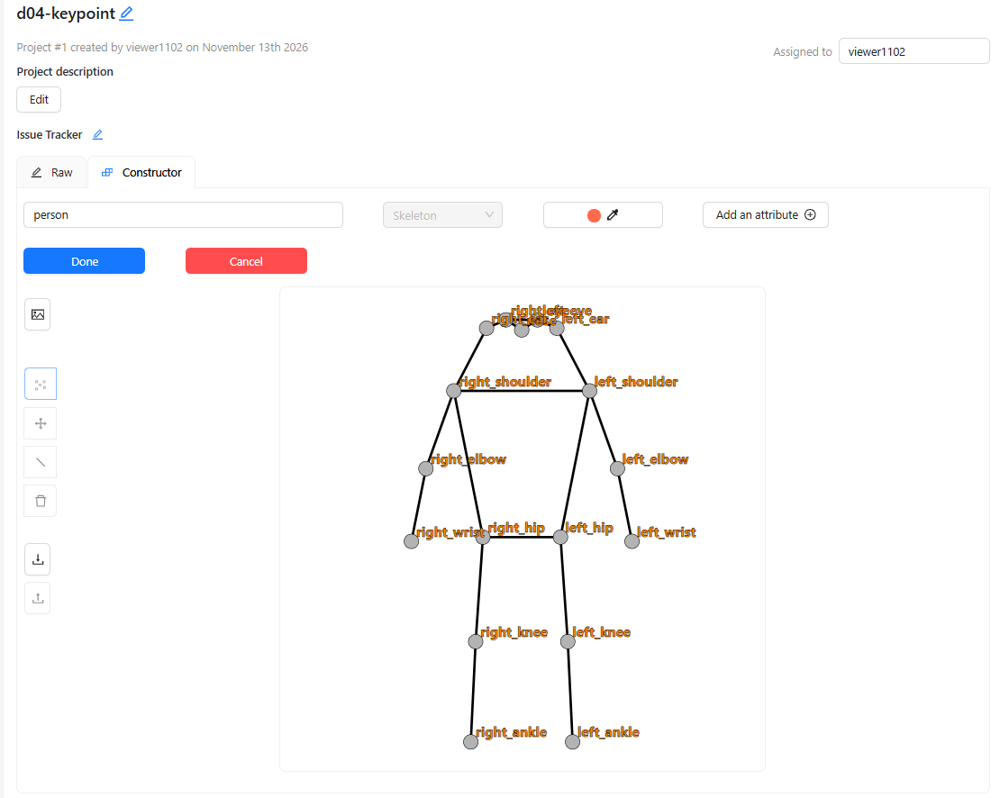
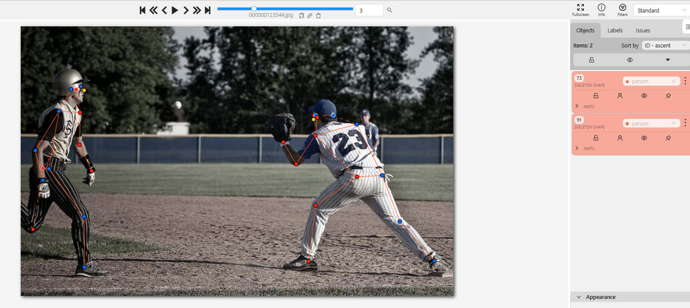
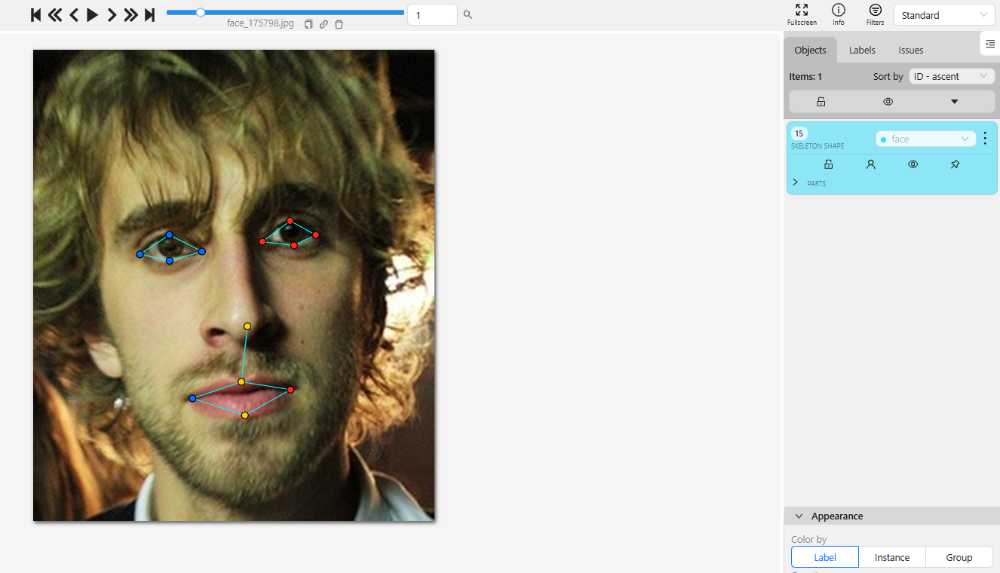
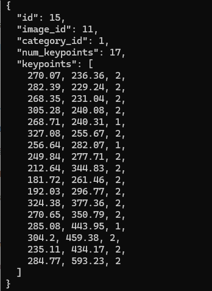

# Báo cáo cá nhân — HoVaTen-MSSV

## 0. Thông tin học viên

- Họ tên: Bùi Thị Thường
- MSSV: 2A202603136
- Email: 26ai.thuongbt@vinuni.edu.vn
- Link repository: https://github.com/viewer1102/K5-L2A-BuiThiThuong-2A202603136-Day04-KeypointPose-Student
- Phiên bản CVAT (Help → About): 2.74.1
- Máy: hệ điều hành Windows 11 Pro · RAM 16 GB · chạy CVAT chế độ đầy đủ / lite
- Bộ ảnh (`src/exports/assignment.json` do `lab.py setup` tạo): có

## 1. Kiểm tra label (CP0)

| Label | Kiểu | Số điểm | Tên điểm đúng bảng của lab? | Đúng thứ tự? | Số cạnh |
|---|---|---:|---|---|---:|
| `person` | Skeleton| 17| có | có | 19|
| `face` | Skeleton| 13| có | có | 13|

Mẫu `person` dựng theo người quay mặt về camera (các điểm `left_*` nằm bên phải khung mẫu)? Có 
Cách đổi cờ `occluded` / `outside` cho **một điểm** trên phiên bản CVAT này : bấm icon đầu tiên bên trái của mỗi part


## 2. Số lượng đã gán và thời gian (CP1, CP2)

| Nhóm ảnh | Số ảnh | Số skeleton đã gán | Số người dưới 60 px (không gán) | Số poster / gương / màn hình bỏ qua | Thời gian (phút) |
|---|---:|---:|---:|---:|---:|
| `easy` | 5 | 5 | | | |
| `occluded` | 3 | 4 | | | |
| `back` | 2 | 3 | | | |
| `small` | 1 | 3 | | | |
| `crowd` | 1 | 1 | | | |
| `faces` | 8 | 8 | — | | |


## 3. Kiểm file xuất và kết quả tự kiểm (CP4)

Tự kiểm tay trong file JSON:

| File | Người / mặt kiểm (ảnh, thứ tự) | Số phần tử `keypoints` | Điểm `outside` ra `v = 0`, `occluded` ra `v = 1`? | `num_keypoints` khớp? |
|---|---|---:|---|---|
| `BuiThiThuong_persons.zip` | 000000022857.jpg, ID 1 | 51 | Có cả v=0 và v=1. Đối chiếu cờ trong CVAT | 13 = 8 + 5 |
| `BuiThiThuong_persons.zip` | 000000078170.jpg, ID 4 | 51 | Có cả v=0 và v=1. Đối chiếu cờ trong CVAT | 9 = 7 + 2 |
| `BuiThiThuong_faces.zip` | face_99874.jpg, ID 8 | 39 | Có 8 điểm v=0 và 5 điểm v=2 | 5 |

Sau khi xuất, CVAT ghi occluded thành v = 1 và outside thành v = 0. Trong bản export của em, các điểm outside vẫn giữ tọa độ cũ.

Hai job đã chuyển sang completed trên CVAT? Có

Dán phần **TÓM TẮT** in ra từ `src/check_submission.py`:

```text
----- TÓM TẮT (dán vào báo cáo mục 5) -----
- File person: BuiThiThuong_persons.zip
  Số ảnh: 12 · số skeleton `person`: 16 · mỗi annotation 51 số
  Skeleton theo ảnh: 000000022857=1, 000000057978=1, 000000078170=2, 000000123544=2, 000000175703=1, 000000183176=1, 000000193879=1, 000000253584=3, 000000314154=1, 000000429594=1, 000000522889=1, 000000558066=1
  Cờ v: v=2 211 (78%) · v=1 33 (12%) · v=0 28 (10%)
  num_keypoints trung bình: 15.2
- File face: BuiThiThuong_faces.zip
  Số ảnh: 8 · số skeleton `face`: 8 · mỗi annotation 39 số
  Skeleton theo ảnh: face_141135=1, face_175798=1, face_3348=1, face_345145=1, face_415073=1, face_469647=1, face_505385=1, face_99874=1
  Cờ v: v=2 96 (92%) · v=1 0 (0%) · v=0 8 (8%)
  num_keypoints trung bình: 12.0
- Ghi chú: 36 điểm v = 0 vẫn mang tọa độ cũ (CVAT 2.x xuất như vậy; chuẩn COCO ghi 0, 0). Không phải lỗi: điểm v = 0 bị bỏ qua khi huấn luyện và khi chấm.
- Số [LỖI]: 0 · số [CẢNH BÁO]: 4
Kết quả: ĐẠT (đọc lại từng cảnh báo ở trên)
```

Các `[CẢNH BÁO]` còn giữ nguyên:
- [CẢNH BÁO] 000000123544.jpg #2: cặp knee nằm ngược phía so với các cặp còn lại. Có thể đổi trái/phải một cặp (`lr_swap`), hoặc tay / chân bắt chéo thật: kiểm lại.
- [CẢNH BÁO] 000000193879.jpg #1: cặp ankle nằm ngược phía so với các cặp còn lại. Có thể đổi trái/phải một cặp (`lr_swap`), hoặc tay / chân bắt chéo thật: kiểm lại.
- [CẢNH BÁO] 000000253584.jpg #1: các điểm chỉ trải cao 49 px (< 60 px). Người dưới 60 px không gán; nếu người cao hơn nhưng bị cắt khung thì bỏ qua cảnh báo này.
- [CẢNH BÁO] 000000522889.jpg #1: cặp knee, ankle nằm ngược phía so với các cặp còn lại. Có thể đổi trái/phải một cặp (`lr_swap`), hoặc tay / chân bắt chéo thật: kiểm lại.


## 4. Ảnh chụp màn hình

1. Label `person` trong label constructor (đủ 17 điểm có tên):

   

2. Một người quay lưng đã gán, cờ đã đặt:

   

3. Một khuôn mặt đã gán 13 điểm, phóng to vùng mắt:

   

4. Một đoạn JSON xuất của một người:

   

Nguồn ảnh: COCO val2017 / Wikimedia Commons.

## 5. Khó khăn và lỗi kỹ thuật

Tôi gán nhãn thủ công trên hai job tự tạo ở CVAT local (#6 và #7). Sau khi chạy setup và thấy hai job được giao (#8 và #9), tôi chuyển nhãn sang các job này bằng export/import. CVAT hiển thị nguồn FILE cho các nhãn được nhập.

Ảnh có người ở xa, người ngồi hoặc bị vật thể che khiến việc định vị khớp và chọn cờ visibility mất nhiều thời gian. Ví dụ, ở ảnh người ngồi trong tàu, phần thân tàu che chân nên khó xác định vị trí gối và cổ chân.